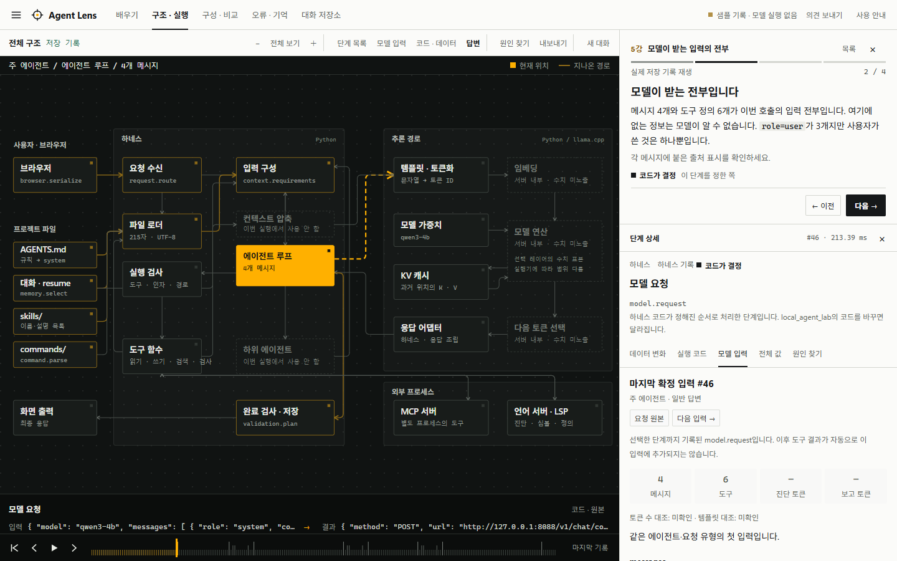

# Agent Lens

[한국어](README.md) · English summary

**Watch what an AI agent actually does, one step at a time, then change it and measure the effect.**

Agent Lens is a small local agent harness that records everything: which files it read, the exact messages sent to the model, each tool call, how the arguments were checked, and why the run was considered finished. Every step is labelled with who decided it: the code, the model, a config file, or the runtime.

> The interface and the lessons are currently in **Korean only**. Code, event names and the raw records are readable in any language.



## Try it

**[Open the web demo](https://paconal888-a11y.github.io/LLM-Agent-viewer/)**: no install and no model. It replays real recorded runs.

To run your own prompts on Windows x64 with Git and [uv](https://docs.astral.sh/uv/getting-started/installation/):

```powershell
git clone https://github.com/paconal888-a11y/LLM-Agent-viewer.git
cd LLM-Agent-viewer
.\Start-AgentLens.ps1 -SamplesOnly          # replay only, no model
.\Start-AgentLens.ps1 -Backend llama        # Qwen3-4B on llama.cpp, downloaded on first run
```

Inference stays on your machine. There is no fallback to a cloud API. Linux and macOS need [manual setup](docs/SETUP.md).

## What it answers

- Who reads `AGENTS.md`, and when? What happens when two rule files conflict?
- When does a skill reach the model, and who decides?
- What does "the model read a file" mean, exactly?
- What disappears as a conversation grows, and where does a stopped task resume from?
- When an answer is wrong, how do you tell a model problem from a harness problem?

14 lessons walk through these questions on real recordings of a local Qwen3 model. Failures are kept in: models that claim work they did not do, a summary that lost facts, a final answer that misquotes a sub-agent.

## What you can do

- Trace a run through an architecture diagram with the source code that ran at each step
- Diff the model input between calls
- Inspect layered rules and settings, deferred folder rules, mid-run context compaction, and checkpoint/resume
- Narrow a failure down: runtime, harness, model input, model choice
- Edit the harness and re-run the same request up to 10 times per condition to compare pass rates
- On the Python backend, inspect tokens, embeddings, Q/K/V, attention, KV cache and sampling

## Limits

This is a teaching harness. It does not reproduce any commercial agent or analyse other tools automatically. The numbers are observations of specific runs, and tensor views are samples from selected layers, not an explanation of why a model answered as it did. See [test results and known limits](docs/REVIEW.md) (Korean).

## License

[MIT](LICENSE). Models and engines have their own licenses: see [third-party notices](THIRD_PARTY_NOTICES.md).
