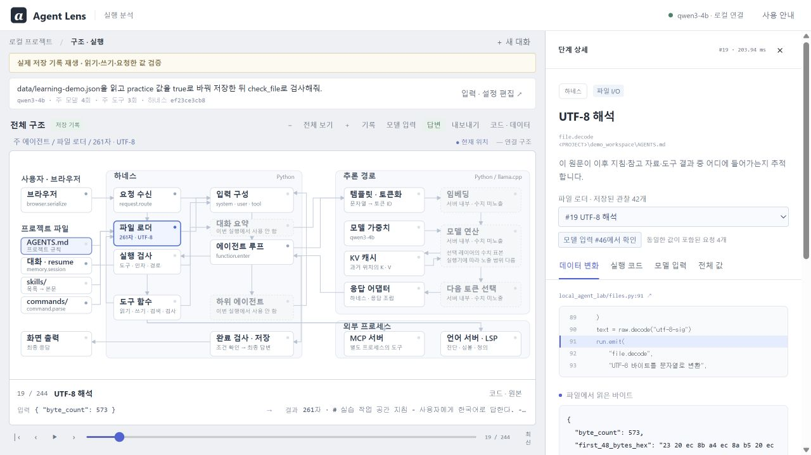
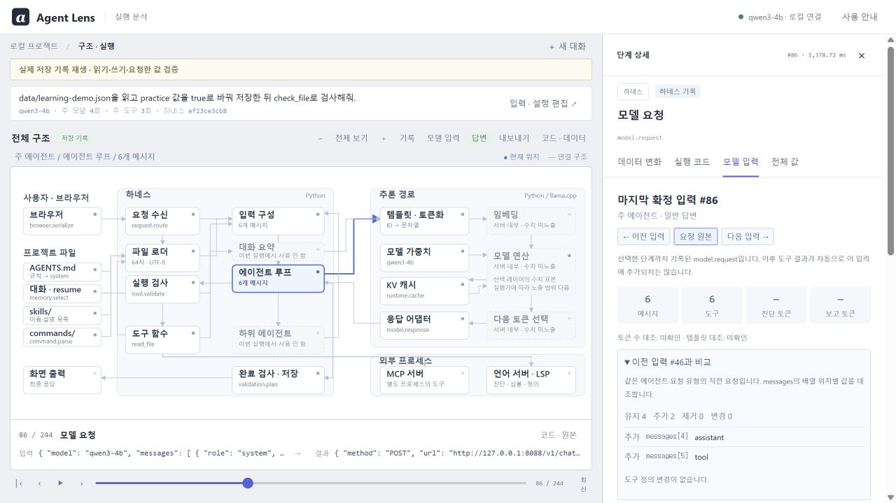
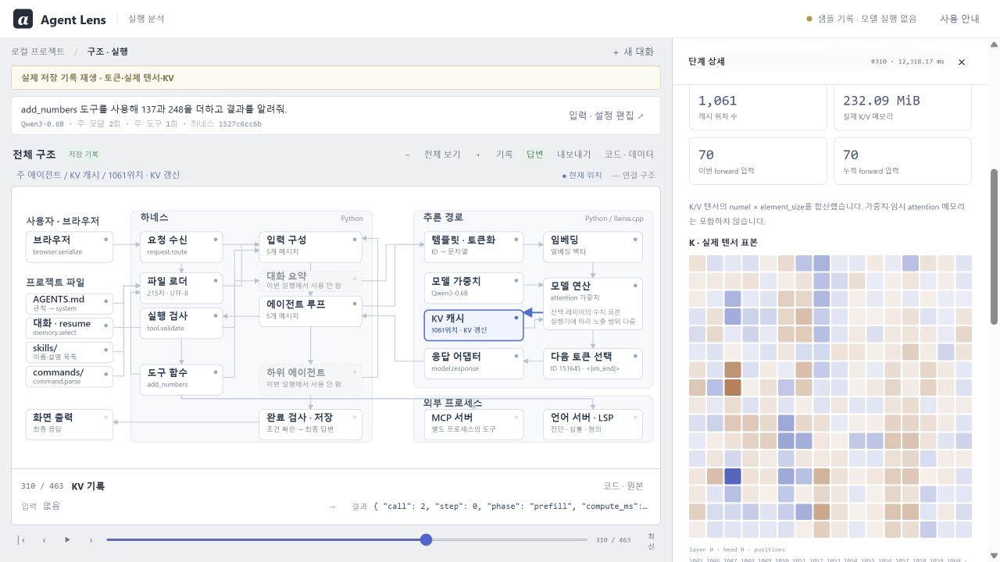
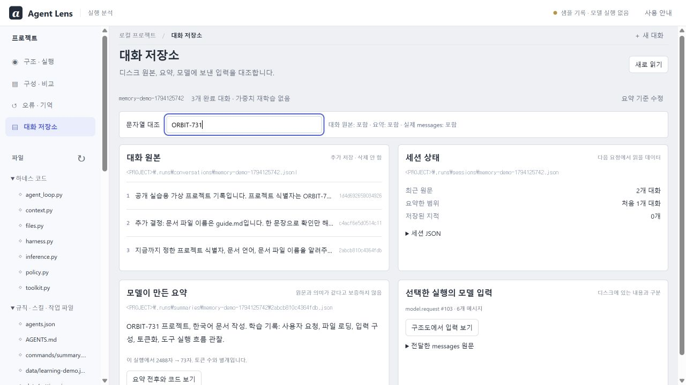

# Agent Lens

[](https://github.com/paconal888-a11y/LLM-Agent-viewer/actions/workflows/tests.yml)
[](https://github.com/paconal888-a11y/LLM-Agent-viewer/releases)
[](LICENSE)

로컬 LLM 에이전트의 실행 과정을 살펴보는 도구입니다. 에이전트가 읽은 파일, 모델에 보낸 메시지, 도구 호출과 결과를 실행 코드와 함께 보여줍니다. 규칙·스킬·하네스를 수정하고 동작의 차이를 비교할 수 있습니다.



[시작하기](#시작하기) · [사용법](docs/WALKTHROUGH.md) · [구조](docs/ARCHITECTURE.md) · [하네스 수정](docs/EXTENDING.md)

## 시작하기

Windows x64, Git, [uv](https://docs.astral.sh/uv/getting-started/installation/)가 필요합니다. Python 3.12는 uv가 준비합니다.

```powershell
git clone https://github.com/paconal888-a11y/LLM-Agent-viewer.git
cd LLM-Agent-viewer
.\Start-AgentLens.ps1 -SamplesOnly
```

[http://127.0.0.1:8765](http://127.0.0.1:8765)에서 왼쪽 **예제 기록**을 선택하세요. 모델 설치 없이 파일 작업, 토큰·KV 캐시, 하위 에이전트, 대화 요약과 반복 응답 중단 등 아홉 개의 실행 기록을 재생할 수 있습니다.

### 로컬 모델로 실행

직접 프롬프트를 입력하려면 다음 중 하나로 실행합니다. 첫 실행에 모델과 의존성을 다운로드하며, 추론에는 외부 모델 API를 사용하지 않습니다.

| 실행기 | 명령 | 용도 |
| --- | --- | --- |
| Python · Qwen3-0.6B | `.\Start-AgentLens.ps1` | CPU에서 토큰별 연산과 텐서 관찰 |
| llama.cpp · Qwen3-4B | `.\Start-AgentLens.ps1 -Backend llama` | 파일 작업과 도구 호출, Vulkan 가속 |

종료는 `.\Stop-AgentLens.ps1`입니다. 설치 옵션과 Linux/macOS 수동 실행은 [설치 안내](docs/SETUP.md)를 참고하세요.

## 기능

- **실행 추적** — 파일 읽기, 메시지 조립, 모델 호출, 도구 실행을 구조도에서 따라가며 입력·출력과 코드 확인
- **입력 비교** — 파일 원문이 포함된 메시지로 이동하고, 모델 호출 사이에 추가·변경된 메시지와 도구 정의 확인
- **하네스 편집** — AGENTS.md, 스킬, 커맨드와 Python 도구 함수를 수정하고 다음 실행에 반영
- **추론 관찰** — 토큰 ID, 임베딩, Q/K/V, attention, KV 캐시, 다음 토큰 선택의 수치 표본
- **대화 관리** — 원문·요약·현재 모델 입력을 비교하고 저장된 요약의 재사용 확인
- **에이전트 모드** — 단일 실행, 계획, 추가 점검, 하위 에이전트별 대화와 도구 권한 비교
- **MCP·LSP 연결** — 외부 서버의 도구 목록·호출·응답과 연결 전후의 토큰·시간 비교

<details>
<summary>모델 입력, KV 캐시와 대화 저장소 화면</summary>

**모델 입력** — 요청 사이의 메시지 변경과 도구 정의를 비교합니다.



**KV 캐시** — 처리한 위치 수, 메모리 사용량, 선택한 레이어의 K/V 표본을 표시합니다.



**대화 저장소** — 원문 파일, 세션 상태, 모델 요약, 요청에 포함된 메시지를 구분합니다.



</details>

## 문서

| 문서 | 내용 |
| --- | --- |
| [설치 안내](docs/SETUP.md) | 실행기 선택, 수동 설치, 저장 경로, 문제 해결 |
| [사용법](docs/WALKTHROUGH.md) | 예제 실행과 화면 조작 |
| [구조](docs/ARCHITECTURE.md) | 처리 흐름, 주요 모듈, 편집 범위 |
| [하네스 수정](docs/EXTENDING.md) | 도구 추가, 규칙·스킬 변경, MCP·LSP 설정 |
| [에이전트 모드](docs/MODES.md) | 역할·권한·호출 예산과 하위 작업 처리 |
| [대화 저장과 요약](docs/MEMORY.md) | 원문 보관, 요약 생성, 다음 입력 선택 |
| [실습](docs/LEARNING.md) | 구성을 바꾸며 확인할 항목 |
| [테스트·측정 결과](docs/REVIEW.md) | 검증 환경, 실행 결과, 알려진 제한 |
| [관련 프로젝트와 명세](docs/REFERENCES.md) | 설계 참고 자료와 프로토콜 문서 |
| [유사 제품 비교](docs/COMPARISON.md) | 비교 대상, 반영한 개선, 남은 차이 |

## 개발

프런트엔드는 빌드 없는 HTML/CSS/JavaScript, 하네스와 HTTP 서버는 Python입니다. 교육용 추론에는 PyTorch/Transformers, LSP에는 python-lsp-server를 사용합니다. 의존성은 `uv.lock`에 고정합니다.

```powershell
uv sync --python 3.12 --extra reference --extra integrations --locked
uv run --extra reference --extra integrations --offline python -m unittest discover -s tests -v
node --test tests/architecture.test.cjs tests/inspection.test.cjs tests/editor.test.cjs
```

Node.js는 구조도·입력 검사·편집기 테스트에만 필요합니다. [이슈](https://github.com/paconal888-a11y/LLM-Agent-viewer/issues)에 재현 절차와 실행기 정보를 남기거나, 변경한 기능의 테스트와 함께 PR을 보내 주세요.

## 지원 범위

텐서 관찰은 Python 실행기의 선택 레이어·위치 표본을 제공합니다. llama.cpp는 서버가 노출하는 응답과 통계를 표시합니다. 대화 요약은 완료한 대화를 다음 요청 전에 처리합니다. MCP는 stdio 도구 연결, LSP는 Python 진단·심볼·정의를 지원합니다.

앱은 로컬 접속용입니다. 편집한 Python 코드와 연결한 도구 서버는 이 PC에서 실행되며, 실행 기록에는 프롬프트와 파일 내용이 포함됩니다. 자세한 관측 범위와 제한은 [테스트·측정 결과](docs/REVIEW.md)에 정리했습니다.

## 라이선스

[MIT](LICENSE). 모델·엔진·라이브러리의 라이선스는 [외부 고지](THIRD_PARTY_NOTICES.md)를 참고하세요.
