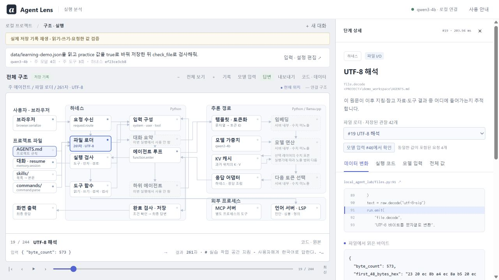
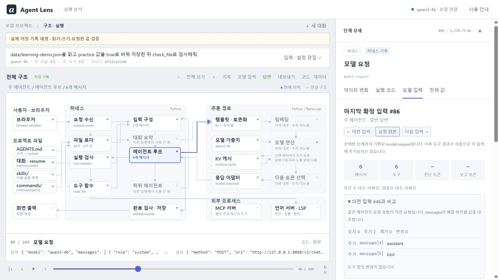
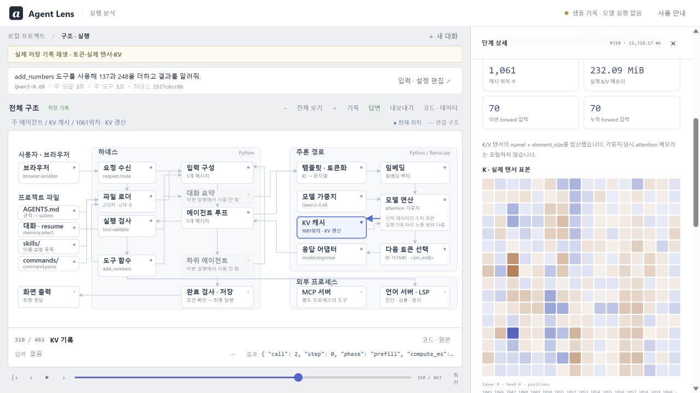
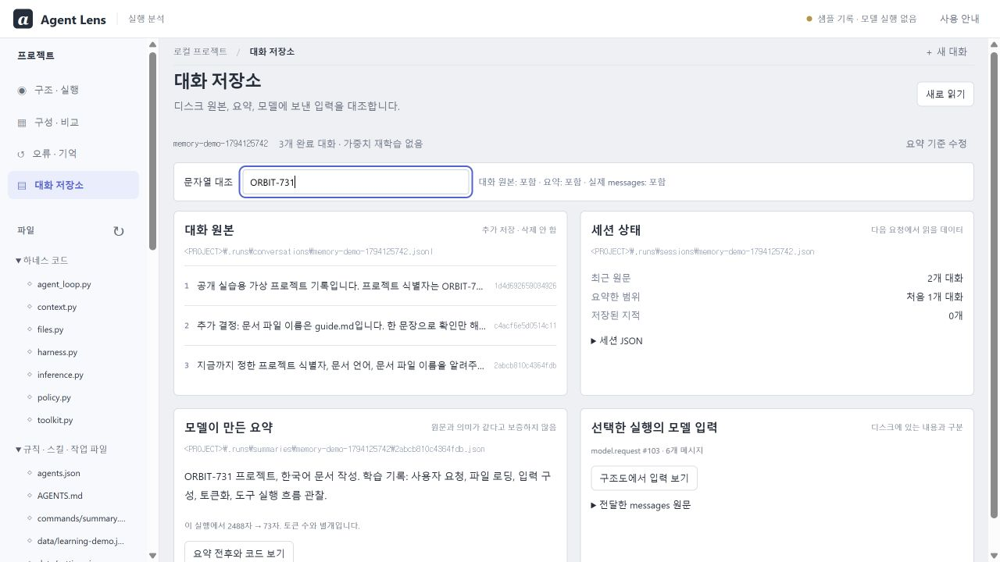

# 한 요청을 따라가 보기

가중치를 설치하기 전에는 `Start-AgentLens.ps1 -SamplesOnly`로 열어 보세요. 아래 화면은 포함된 실제 기록을 새 구조도에서 재생한 것입니다. 개인 경로만 익명화했습니다.

## 1. AGENTS.md를 읽는 주체

왼쪽 **읽기·쓰기·요청한 값 검증**을 선택합니다. **기록**을 열어 `file.read`와 `file.decode`를 선택하거나 구조도의 파일 로더를 누릅니다. **코드 · 원본**에서 호출 스택과 당시 강조 줄을 확인합니다.

`discover_rules()`가 후보 경로를 만들고 `read_traced()`를 호출합니다. 모델이 실행하기 전에 하네스 코드가 하는 일입니다. `rules.wrap`와 `model.request`를 이어서 선택하면 읽은 문자열이 system 메시지로 들어간 위치를 볼 수 있습니다.

`file.decode` 상세의 **모델 입력에서 확인**을 누르면 해당 원문을 포함한 요청과 메시지가 열립니다. system 본문은 기본 지침·프로젝트 규칙·스킬 목록으로 나눠 볼 수 있습니다. **값이 일치하는 기록**에서 파일 읽기 단계로 돌아갑니다. 원문이 입력에 포함된 사실과 모델이 지침을 따른 결과는 별도로 확인합니다.

## 2. 모델이 요청하고, 하네스가 실행한다

같은 기록의 도구 함수를 선택합니다. `model.response`의 `tool_calls`, `tool.validate`의 인자, `tool.result`의 반환값, `context.append`의 messages를 차례로 확인합니다. 다시 호출된 모델은 이 결과를 입력으로 받습니다.

**모델 입력**에서 **다음 입력**을 선택하면 직전 요청과 비교합니다. messages 배열의 추가·제거·변경과 tools schema 변경을 펼쳐 보세요. 주·하위 에이전트, 요약·일반 답변은 서로 섞어서 비교하지 않습니다. 선택한 단계에서 아직 얻지 않은 토큰 수는 `—`로 표시됩니다.

쓰기 예제는 read_file·write_file·check_file과 JSON 실제 값을 완료 조건에 대조합니다. 모델이 말로만 수정했다고 답하면 조건이 충족되지 않습니다. 일반 프롬프트 전체의 의도를 자동 판정하는 기능은 아니므로 조건과 실제 결과를 같이 보세요.

## 3. 토큰 ID가 실제 계산에 들어간다

**토큰·실제 텐서·KV** 기록에서 토큰화와 KV 캐시를 선택합니다. 수치 탭은 교육용 Qwen3-0.6B의 실제 계산 표본입니다.

첫 계산은 입력 전체를 처리하고, KV를 사용하는 다음 계산은 저장된 이전 위치의 K/V를 활용합니다. 캐시의 shape·바이트·처리 위치가 어떻게 바뀌는지 확인하세요. K/V 색깔이나 attention 값으로 숨겨진 사고의 의미를 해독할 수 있는 것은 아닙니다.

## 4. 요약된 기억과 원문은 다른 데이터다

**대화 원문 → 모델 요약 → 다음 입력** 기록에서 **대화 저장소**를 엽니다.

문자열 대조에 `ORBIT-731`을 넣어 봅니다. 요약 전후·저장 파일·다음 요청을 각각 확인합니다. 이어서 **저장한 요약을 다음 요청에서 재사용**을 열면 요약을 다시 생성하지 않은 사실도 볼 수 있습니다. [구현 순서와 한계](MEMORY.md)를 함께 읽으세요.

## 5. 직접 바꾸고 다시 실행한다

실제 모델을 준비했다면 새 대화에서 규칙 한 문장, 스킬 본문, 도구 함수 중 하나를 바꿉니다. **구성 · 비교**는 같은 요청을 두 구성으로 실제 실행합니다. 입력·도구 수·프로토콜 왕복·토큰·시간을 대조한 뒤 답변의 근거를 확인하세요. 모드·MCP·LSP의 자세한 범위는 [모드](MODES.md), [확장](EXTENDING.md), [학습 순서](LEARNING.md)에 있습니다.
